# InferX-ML Cloud-Native AWS Deployment Plan

This document outlines the architecture and deployment strategy for migrating the **InferX-ML** application from a local Docker Compose setup to a fully managed, scalable, and highly available cloud-native architecture on **Amazon Web Services (AWS)**.

---

## 🏗️ Cloud-Native Target Architecture

The target architecture leverages AWS serverless and fully-managed services to minimize operational overhead, maximize security, and provide elastic auto-scaling for both computing resources and machine learning training workloads.

```mermaid
graph TD
    %% Internet & Entry Points
    User([User Browser]) -->|HTTPS: Port 443| CF[Amazon CloudFront]
    CF -->|Static Assets| S3Web[S3 Web Bucket - React SPA]
  
    User -->|API & Websockets| ALB[Application Load Balancer]
  
    %% Networking & Load Balancing
    subgraph VPC [AWS VPC - 10.0.0.0/16]
        subgraph PublicSubnets [Public Subnets - Multi-AZ]
            ALB
            NAT[NAT Gateways]
        end
      
        subgraph PrivateAppSubnets [Private App Subnets - Multi-AZ]
            API[ECS Fargate: Flask API]
            Streamlit[ECS Fargate: Streamlit Predictions]
            Mailer[ECS Fargate: Node Mailer / SES Integration]
        end
      
        subgraph PrivateWorkerSubnets [Private GPU/Worker Subnets]
            Worker[ECS on EC2: Celery ML Workers with GPU/CPU Autoscaling]
        end
      
        subgraph PrivateDataSubnets [Private Data Subnets - Multi-AZ]
            RDS[(Amazon RDS PostgreSQL)]
            ElastiCache[(Amazon ElastiCache Redis)]
        end
    end
  
    %% External Integrations & Storage
    API -->|Read/Write Datasets| S3Data[Amazon S3: Model Vault & Datasets]
    Worker -->|Read/Write Datasets| S3Data
    API -->|Write Jobs| ElastiCache
    Worker -->|Listen for Jobs| ElastiCache
    API -->|Relational Data| RDS
    Worker -->|Commit Results| RDS
  
    %% Services
    Mailer -->|Send Emails| SES[Amazon Simple Email Service]
  
    %% Credentials & Configs
    Secrets[AWS Secrets Manager] -.->|Inject Env Vars| API
    Secrets -.->|Inject Env Vars| Worker
  
    style VPC fill:#111,stroke:#333,stroke-width:2px;
    style PublicSubnets fill:#1b1b1b,stroke:#555,stroke-width:1px;
    style PrivateAppSubnets fill:#1b1b1b,stroke:#555,stroke-width:1px;
    style PrivateWorkerSubnets fill:#1b1b1b,stroke:#555,stroke-width:1px;
    style PrivateDataSubnets fill:#1b1b1b,stroke:#555,stroke-width:1px;
    style CF fill:#059669,stroke:#10b981,color:#fff;
    style ALB fill:#0284c7,stroke:#0ea5e9,color:#fff;
    style RDS fill:#7c2d12,stroke:#ea580c,color:#fff;
    style S3Web fill:#1e1b4b,stroke:#4f46e5,color:#fff;
    style S3Data fill:#1e1b4b,stroke:#4f46e5,color:#fff;
    style Worker fill:#581c87,stroke:#8b5cf6,color:#fff;
```



---

## 🛠️ AWS Component Mapping

The local Docker Compose services map directly to cloud-native, managed AWS equivalents:

| Local Container Service  | AWS Cloud-Native Equivalent            | Rationale & Configuration                                                                                                            |
| :----------------------- | :------------------------------------- | :----------------------------------------------------------------------------------------------------------------------------------- |
| **React Frontend** | **Amazon S3 + CloudFront**       | High availability, lower latency via global Edge Locations, and massive cost savings compared to running Node container instances.   |
| **Flask Backend**  | **AWS ECS on Fargate**           | Serverless container orchestration. Scaled dynamically based on CPU/Memory usage.                                                    |
| **Streamlit App**  | **AWS ECS on Fargate**           | Independent deployment, scaling separately from main API endpoints.                                                                  |
| **PostgreSQL**     | **Amazon RDS PostgreSQL**        | Multi-AZ replication for automated backups, security patching, and high availability.                                                |
| **Redis**          | **Amazon ElastiCache Redis**     | Fully-managed memory broker/cache providing extreme durability and speed for Celery tasks.                                           |
| **MinIO**          | **Amazon S3**                    | S3 API compatible with unlimited, secure durability and fine-grained IAM policy controls.                                            |
| **Mailer Service** | **AWS SES**                      | Replaced directly by**AWS Simple Email Service (SES)** via AWS SDK or IAM-authorized SMTP credentials.                         |
| **Celery Workers** | **AWS ECS on EC2 (GPU-enabled)** | Utilizes GPU container instances (e.g.,`g4dn` / `g5` families) dynamically scale down to `0` when the training queue is empty. |

---

## 🔒 VPC & Network Infrastructure Setup

1. **Subnets Architecture**:

   * **Public Subnets**: Houses the Application Load Balancer (ALB) and NAT Gateways. Direct ingress is protected via AWS Shield & AWS WAF.
   * **Private Application Subnets**: Hosts Flask API, Mailer, and Streamlit containers. Direct internet access is blocked; egress goes through NAT Gateways.
   * **Private Worker Subnets**: Contains GPU-intensive ML training instances isolated securely from the web.
   * **Private Database Subnets**: Isolated subnets exclusively accessible by the Application and Worker layers.
2. **Security Groups Rules (Least Privilege)**:

   * **ALB Security Group**: Allows ports `80` and `443` from `0.0.0.0/0`.
   * **App Security Group**: Allows port `5000` (API) and `8501` (Streamlit) **only** from the ALB Security Group.
   * **RDS Security Group**: Allows port `5432` **only** from the App Security Group and Worker Security Group.
   * **Redis Security Group**: Allows port `6379` **only** from the App Security Group and Worker Security Group.

---

## 📂 Step-by-Step Deployment Instructions

### Phase 1: Storage and Databases

* **Amazon S3 Bucket**:
  * Create an S3 Bucket (e.g., `inferx-datasets-vault`).
  * Enable Default Encryption (SSE-S3) and Block Public Access.
* **Amazon RDS PostgreSQL**:
  * Deploy RDS instance (Engine: PostgreSQL 15, DB Instance Class: `db.t4g.medium` or higher for prod).
  * Put in private database subnets.
* **Amazon ElastiCache Redis**:
  * Deploy serverless ElastiCache cluster with encryption-in-transit enabled.

### Phase 2: React Frontend Build & Cloud Distribution

1. Build the frontend statically:
   ```bash
   cd frontend
   npm install
   # Set API endpoint to production ALB domain
   VITE_API_URL=https://api.yourdomain.com/api npm run build
   ```
2. Sync build files to S3 Web Hosting Bucket:
   ```bash
   aws s3 sync dist/ s3://inferx-frontend-bucket/ --delete
   ```
3. Set up **Amazon CloudFront** distribution with the S3 bucket as its origin. Configure:
   * **SSL Certificate** via AWS Certificate Manager (ACM).
   * **Routing Rules**: Redirect HTTP requests to HTTPS, and route standard paths directly to `/index.html` (SPA fallback).

### Phase 3: Containerizing & Registering Backend Images

1. Create registries in **Amazon Elastic Container Registry (ECR)**:
   * `inferx-backend`
   * `inferx-streamlit`
2. Build and push backend images using AWS CLI:
   ```bash
   # Log in to ECR
   aws ecr get-login-password --region us-east-1 | docker login --username AWS --password-stdin <aws_account_id>.dkr.ecr.us-east-1.amazonaws.com

   # Build & push backend
   docker build -t inferx-backend -f docker/Dockerfile.backend .
   docker tag inferx-backend:latest <aws_account_id>.dkr.ecr.us-east-1.amazonaws.com/inferx-backend:latest
   docker push <aws_account_id>.dkr.ecr.us-east-1.amazonaws.com/inferx-backend:latest
   ```

### Phase 4: ECS Tasks & Deployments

1. **Secrets Management**: Store API keys (`GEMINI_API_KEY`, `RAZORPAY_KEY_SECRET`, `GOOGLE_CLIENT_SECRET`, etc.) inside **AWS Secrets Manager**.
2. **ECS Task Definitions**:Map database connections directly using RDS endpoint DNS:
   `postgresql://<user>:<password>@<rds-endpoint>:5432/inferx_ml`

   Map S3 variables replacing MinIO endpoints:


   * `S3_USE_AWS=true`
   * `AWS_STORAGE_BUCKET_NAME=inferx-datasets-vault`
   * Mount IAM Task Execution Roles directly to tasks so containers securely write to S3 without managing raw Access/Secret Keys inside environmental variables.
3. **Setup Auto-Scaling for GPU workers**:

   * Set up Celery training container task scaling policies based on ElastiCache metrics (`UnreceivedMessages` queue length). When queue > `0`, spin up EC2 GPU instances; scale down to `0` when tasks finish.

---

## 🚀 CI/CD Pipeline (GitHub Actions Automation)

A production-grade CI/CD pipeline built with **GitHub Actions** automates code building, image containerization, static assets deployment, and container service rolling updates to AWS.

### 🔑 Prerequisites & IAM Configuration
1. Create a **GitHub Repository Secret** for AWS authentication:
   * `AWS_ACCESS_KEY_ID`: Dedicated IAM deployment credentials.
   * `AWS_SECRET_ACCESS_KEY`: Dedicated IAM deployment credentials.
2. Ensure the deployment role has permissions for: `ecr:*`, `ecs:*`, `s3:*`, and `cloudfront:CreateInvalidation`.

### 📂 GitHub Actions Workflow Configuration
Create a file at `.github/workflows/deploy.yml` with the following configuration:

```yaml
name: Deploy InferX-ML to AWS Cloud-Native

on:
  push:
    branches:
      - main

env:
  AWS_REGION: us-east-1
  ECR_BACKEND_REGISTRY: inferx-backend
  ECS_CLUSTER: inferx-production-cluster
  ECS_BACKEND_SERVICE: inferx-backend-service
  ECS_BACKEND_TASK_DEFINITION: .aws/backend-task-def.json
  S3_FRONTEND_BUCKET: inferx-frontend-bucket
  CLOUDFRONT_DISTRIBUTION_ID: E2XXXXXXXXXXXX

jobs:
  # Job 1: Build & Deploy Frontend (React SPA)
  deploy-frontend:
    runs-on: ubuntu-latest
    steps:
      - name: Checkout Code
        uses: actions/checkout@v3

      - name: Setup Node.js
        uses: actions/setup-node@v3
        with:
          node-version: 18
          cache: 'npm'
          cache-dependency-path: frontend/package-lock.json

      - name: Install & Build React Frontend
        run: |
          cd frontend
          npm ci
          VITE_API_URL=https://api.yourdomain.com/api npm run build

      - name: Configure AWS Credentials
        uses: aws-actions/configure-aws-credentials@v2
        with:
          aws-access-key-id: ${{ secrets.AWS_ACCESS_KEY_ID }}
          aws-secret-access-key: ${{ secrets.AWS_SECRET_ACCESS_KEY }}
          aws-region: ${{ env.AWS_REGION }}

      - name: Sync static files to S3
        run: |
          aws s3 sync frontend/dist/ s3://${{ env.S3_FRONTEND_BUCKET }}/ --delete

      - name: Invalidate CloudFront Cache
        run: |
          aws cloudfront create-invalidation --distribution-id ${{ env.CLOUDFRONT_DISTRIBUTION_ID }} --paths "/*"

  # Job 2: Build, Push & Deploy Backend Container (Flask API)
  deploy-backend:
    runs-on: ubuntu-latest
    steps:
      - name: Checkout Code
        uses: actions/checkout@v3

      - name: Configure AWS Credentials
        uses: aws-actions/configure-aws-credentials@v2
        with:
          aws-access-key-id: ${{ secrets.AWS_ACCESS_KEY_ID }}
          aws-secret-access-key: ${{ secrets.AWS_SECRET_ACCESS_KEY }}
          aws-region: ${{ env.AWS_REGION }}

      - name: Log in to Amazon ECR
        id: login-ecr
        uses: aws-actions/amazon-ecr-login@v1

      - name: Build, tag, and push Docker image to ECR
        id: build-image
        env:
          ECR_REGISTRY: ${{ steps.login-ecr.outputs.registry }}
          IMAGE_TAG: ${{ github.sha }}
        run: |
          docker build -t $ECR_REGISTRY/${{ env.ECR_BACKEND_REGISTRY }}:$IMAGE_TAG -f docker/Dockerfile.backend .
          docker push $ECR_REGISTRY/${{ env.ECR_BACKEND_REGISTRY }}:$IMAGE_TAG
          echo "image=$ECR_REGISTRY/${{ env.ECR_BACKEND_REGISTRY }}:$IMAGE_TAG" >> $GITHUB_OUTPUT

      - name: Fill in the new image ID in the Amazon ECS task definition
        id: task-def
        uses: aws-actions/amazon-ecs-render-task-definition@v1
        with:
          task-definition: ${{ env.ECS_BACKEND_TASK_DEFINITION }}
          container-name: backend
          image: ${{ steps.build-image.outputs.image }}

      - name: Deploy Amazon ECS task definition
        uses: aws-actions/amazon-ecs-deploy-task-definition@v1
        with:
          task-definition: ${{ steps.task-def.outputs.task-definition }}
          service: ${{ env.ECS_BACKEND_SERVICE }}
          cluster: ${{ env.ECS_CLUSTER }}
          wait-for-service-stability: true

---

## 📈 High Availability & Disaster Recovery (DR)

* **Multi-AZ Availability**: ALB distributes traffic across 3 Availability Zones (AZs) seamlessly. RDS automatically shifts to a standby replica during a zone failure.
* **Auto-Scaling**: ECS dynamically spins up additional task instances upon CPU utilization spikes (> 70%).
* **Scheduled Backups**: Automated RDS snapshots taken daily with multi-region replication enabled for catastrophic recovery plans.
